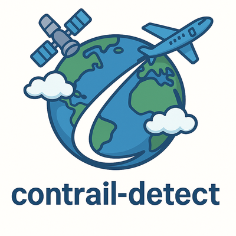

<p align="center">
  
</p>

# contrail-detect

[](https://github.com/itcojo/contrail-detect/actions/workflows/ci.yml)
[](pyproject.toml)
[](https://github.com/itcojo/contrail-detect/blob/main/LICENSE)
[](https://github.com/itcojo/contrail-detect/blob/main/CITATION.cff)
[](https://doi.org/10.5281/zenodo.24063067)

`contrail-detect` is a Python package for detecting contrails in geostationary satellite imagery, decomposing the detections into individual contrails, tracking them across successive images, and attributing them to the flights that formed them. It supports GOES-16/18/19 (Full Disk, CONUS, and Mesoscale), Himawari-8/9, and Meteosat Third Generation (MTG). Contrail detections can come from a local detection model, the Contrails.org API, or the Google Contrails API, and flight data from the Contrails.org ADS-B API or your own ADS-B data.

The package is organised around the steps of the detection and attribution workflow described in Itcovitz et al. (in prep.), as outlined in [Project Structure](#project-structure).

> This is version 1.13.1 of `contrail-detect`, the code used for Itcovitz et al. (in prep.). This frozen snapshot will not be developed further here, as its functionality is being integrated into [pycontrails](https://github.com/contrailcirrus/pycontrails). Bug reports and questions are nevertheless welcome (see [Contributing](#contributing)), and may be carried forward in pycontrails.

> Only the GOES Full Disk code is finalised. The GOES CONUS (and its GOES-West equivalent, PACUS) and Mesoscale regions, and the Himawari and MTG code, can be run in various capacities but have not been calibrated, and the matching configurations are those tailored for GOES-East Full Disk.


## Installation

`contrail-detect` requires Python 3.11 or newer. It is not published on PyPI, so clone the repository and install it in editable mode:

```bash
git clone https://github.com/itcojo/contrail-detect.git
cd contrail-detect
# With Jupyter, for the example notebooks
pip install -e ".[examples]"
# Also with the local detection model (PyTorch, ~2 GB)
pip install -e ".[examples,local]"
```

The default installation covers satellite data access, flight data, decomposition, tracking, and matching, with detections from the Contrails.org or Google Contrails APIs. The `[local]` extra adds the dependencies needed to run the detection model on your own machine, and `[examples]` adds Jupyter. The model weights are downloaded separately (see [Local Model Weights](#local-model-weights)).

### Data Directory

Downloads (flight data, ERA5, and model weights), caches, and outputs are stored in the first of the following that applies:

1. `CONTRAILS_DATA_DIR`, if it is set to a non-empty value.
2. `contrail_detect/data/` within the repository, when the package is installed in editable mode (`pip install -e`) from a writable clone, as above. Model weights then go in `contrail_detect/models/kaggle_contrails_solution/input/weights/`, and figures in `figures/`.
3. `~/.contrail-detect/` in your home directory otherwise, i.e., if the clone is not writable (e.g., a shared, read-only copy) or the package was installed without `-e`. Model weights then go in `~/.contrail-detect/weights/`.

`CONTRAILS_DATA_DIR` can be set as an environment variable or in `~/.env`:

```bash
CONTRAILS_DATA_DIR=/path/to/contrail-data
```

`~` and environment variables (e.g., `$HOME`) are expanded, and a relative path is taken relative to the working directory at import. Importing the package does not create the directory, but if it does not exist yet, its location is logged at INFO level by the `contrail_detect.core.config` logger.

### Local Model Weights

The local detection model is adapted from the [winning solution](https://www.kaggle.com/code/junkoda/contrails-submit/) to the [Google Research Identify Contrails to Reduce Global Warming](https://www.kaggle.com/competitions/google-research-identify-contrails-reduce-global-warming) Kaggle competition, which combines a U-Net variant and a vision transformer. Its code is in `contrail_detect/models/kaggle_contrails_solution/`, under its authors' own MIT licence (`LICENSE` in that folder).

The model weights (~4.5 GB) are not distributed with this package. Download them from the [original Kaggle solution](https://www.kaggle.com/code/junkoda/contrails-submit/) and place them in the weights folder of your [data directory](#data-directory):

- `contrail_detect/models/kaggle_contrails_solution/input/weights/` for an editable install from a writable clone;
- `~/.contrail-detect/weights/` if the clone is not writable, or the package was installed without `-e`;
- `$CONTRAILS_DATA_DIR/weights/` if `CONTRAILS_DATA_DIR` is set.

The `pip` packages included in the Kaggle download are not needed, as the `[local]` extra installs them.


## Third-Party Data Access

API keys are read from environment variables, which can also be set in `~/.env`:

```bash
# Contrails.org detections and ADS-B
CONTRAILS_API_KEY=<your-contrails-org-key>
# Google Contrails API detections
GOOGLE_CONTRAILS_API_KEY=<your-google-api-key>
```

### Contrail Detections

Three detection sources share the same interface:

- `LocalContrailModel` (`method='local'`) runs the detection model on your own machine. It needs the `[local]` extra and the model weights, and a GPU is strongly recommended.
- `ContrailsAPIContrailModel` (`method='contrails_api'`) downloads GOES-16/19 detection masks from the [Contrails.org](https://contrails.org) API, which uses the same detection model. It needs a Contrails.org API key.
- `GoogleAPIContrailModel` (`method='google_api'`) downloads detection masks for GOES-East, GOES-West, Himawari-9, and MTG from the [Google Contrails API](https://developers.google.com/contrails/reference/v2). It needs a Google API key. These detections come from a different model.

Detection scores are converted into contrail pixels by applying a threshold, which depends on the source: 0.30 for the local model and Contrails.org, and 0.40 for Google, where its precision and recall are equal. Pass `prediction_threshold` to use a different value.

Coverage depends on the provider, the satellite, and the region. The detections do not cover the full disk, and their available dates vary, so check the detections returned (and the provider's documentation) before relying on a particular time or region.

### Flight Data (ADS-B)

- `ContrailsAPIFlightData` downloads global ADS-B telemetry from the [Contrails.org ADS-B API](https://api.contrails.org/openapi#/ADS-B/adsb_telemetry_v1_adsb_telemetry_get). It needs a Contrails.org API key.
- `GenericFlightData` loads ADS-B data you already have.

The Contrails.org API serves one hour of global data at a time, and only for hours more than 48 hours old. `req_bbox` and `target_addresses` filter the data after download. Each hour is cached in the data directory, so repeated runs only download new hours. Failed requests are retried, and if an hour still cannot be downloaded, `download_from_api` raises an error naming it, since a gap would leave its contrails unmatched or matched to the wrong flight. Pass `allow_missing_hours=True` to continue without it.

Your own data needs one row per position report, with at least the columns `flight_id`, `time` (UTC), `latitude`, `longitude`, and `altitude_ft`. `altitude_ft` should be the geometric (GNSS) altitude in feet, which is used for the parallax adjustment. If you also have barometric altitude, add it as `pressure_altitude_ft` (feet), which is used to select the ERA5 wind level. Without it, `altitude_ft` is used for both. Data can be loaded from a Parquet, CSV, or JSON file with `load_from_file`, or from a DataFrame with `load_from_dataframe`.

### Meteorological Data (ERA5)

Flight advection and wind-initialised tracking use ERA5 winds from the [Copernicus Climate Data Store (CDS)](https://cds.climate.copernicus.eu/). This requires a free CDS account and a credentials file at `~/.cdsapirc`:

```ini
url: https://cds.climate.copernicus.eu/api
key: <your-cds-api-key>
```

Alternatively, set the `CDSAPI_URL` and `CDSAPI_KEY` environment variables, or pass the directory containing the file as `path_to_key`. Before your first download, accept the licence at the bottom of the [ERA5 pressure levels](https://cds.climate.copernicus.eu/datasets/reanalysis-era5-pressure-levels) page, as CDS rejects requests until you do.

`get_era5_from_local` downloads ERA5 one day at a time and caches each day in the data directory. Wind-initialised tracking (`initialize_tracking_windspeeds`) downloads through the same function. CDS queues requests, so a first download can take from minutes to hours.


## Quickstart

The following detects, decomposes, and tracks contrails over two hours of GOES-East Full Disk imagery, and then matches them to flights. It uses Contrails.org detections and flight data and ERA5 winds, so it needs a Contrails.org API key and a CDS account (see [Third-Party Data Access](#third-party-data-access)).

```python
import numpy as np

from contrail_detect.flights.contrails_api import ContrailsAPIFlightData
from contrail_detect.geostationary.goes import GOESDetector
from contrail_detect.matching import Matcher, match_tracks
from contrail_detect.meteorology.ecmwf import get_era5_from_local

start = np.datetime64("2026-01-09T15:00")
end = np.datetime64("2026-01-09T17:00")
detector = GOESDetector(
    goes_satellite="GOES-19",
    goes_region="F",
    start_time=start,
    end_time=end,
)

# Detection masks, decomposed contrails, and tracks across frames
detector.detections = detector.get_detections(method="contrails_api")
summary, clouds = detector.get_decomposed_contrails(method="decomposer")
detector.contrail_summary = summary
detector.contrail_point_clouds = clouds
detector.get_tracking_output()

# Flights advected with ERA5 winds to each pixel's scan time
adv_max = np.timedelta64(60, "m")
flights = ContrailsAPIFlightData(
    req_timestamps=detector.timestamp_sequence,
    adv_max=adv_max,
)
flights.download_from_api()

# Winds from (first frame - lookback) to the end of the last frame
frames = detector.timestamp_sequence
met = get_era5_from_local(
    times=[frames[0] - adv_max, frames[-1] + (frames[1] - frames[0])],
    met_variables=["eastward_wind", "northward_wind"],
)
winds = {"eastward_wind": "u", "northward_wind": "v"}
flights.ecmwf_data = met.rename(winds)
flights.advect_flights_to_scan_times(
    detector=detector,
    adv_max_past=adv_max,
    adv_timestep=10,
)

# Score candidate flights for each track and keep confident matches
matcher = Matcher(detector=detector, flights=flights)
matcher.run_matching()
matched = match_tracks(matcher.matching_results, preset="default")
```

`examples/goes_pipeline.ipynb` runs the same workflow with every setting shown.


## Examples

The example notebooks in `examples/` require a clone of the repository. We recommend starting with `goes_pipeline.ipynb`, which demonstrates the full workflow with default settings: loading satellite imagery, detecting contrails (with any of the sources above), decomposing the detection masks, accessing meteorological and flight data, tracking contrails, and matching them to flights. The remaining examples are:

- `himawari_pipeline.ipynb`, for Himawari-9;
- `mtg_pipeline.ipynb`, for Meteosat Third Generation;
- `inference_demo.py`, which runs the local detection model as a script.


## Project Structure

```text
├── assets/
├── contrail_detect/
│   ├── core/              # Configuration and shared utilities
│   ├── data/              # Default data directory (not committed)
│   ├── decomposition/     # Decomposition and stitching
│   ├── flights/           # Flight data, advection, and parallax
│   │   ├── contrails_api.py   # Contrails.org ADS-B API
│   │   ├── generic.py         # Your own ADS-B data
│   │   └── ...
│   ├── geostationary/     # Satellite imagery and scan times
│   ├── matching/          # Scoring and matching thresholds
│   ├── meteorology/       # ERA5 winds
│   ├── models/            # Per-pixel detection scores
│   │   ├── kaggle_contrails_solution/   # Third-party (MIT)
│   │   ├── local_model.py     # Local detection model
│   │   ├── contrails_api.py   # Contrails.org API
│   │   └── google_api.py      # Google Contrails API
│   └── tracking/          # Tracking across successive images
├── examples/              # Example notebooks
├── tests/
├── CHANGELOG.md
├── CITATION.cff
├── LICENSE
├── NOTICE
└── pyproject.toml
```


## Contributing

As this repository is a frozen snapshot, it does not accept pull requests. Please report bugs as [GitHub Issues](https://github.com/itcojo/contrail-detect/issues) (see [CONTRIBUTING.md](https://github.com/itcojo/contrail-detect/blob/main/.github/CONTRIBUTING.md) for what to include), and ask questions in [GitHub Discussions](https://github.com/itcojo/contrail-detect/discussions). To report a security vulnerability, see [SECURITY.md](https://github.com/itcojo/contrail-detect/blob/main/.github/SECURITY.md).


## Citation & Licence

If you use this package, please cite it using [CITATION.cff](https://github.com/itcojo/contrail-detect/blob/main/CITATION.cff). This version is archived on Zenodo ([doi:10.5281/zenodo.24063067](https://doi.org/10.5281/zenodo.24063067)), and its contents are summarised in [CHANGELOG.md](https://github.com/itcojo/contrail-detect/blob/main/CHANGELOG.md).

This project is licensed under the MIT License (see [LICENSE](https://github.com/itcojo/contrail-detect/blob/main/LICENSE) and [NOTICE](https://github.com/itcojo/contrail-detect/blob/main/NOTICE)).


## Acknowledgements

We thank the Google Research team for the [contrail detection competition](https://www.kaggle.com/competitions/google-research-identify-contrails-reduce-global-warming) and its publicly available data, and Jun Koda for the [winning solution](https://www.kaggle.com/code/junkoda/contrails-submit) on which the local detection model is based. Satellite imagery is from [NOAA](https://www.goes.noaa.gov/), [JMA](https://www.jma.go.jp/jma/jma-eng/satellite/), and [EUMETSAT](https://www.eumetsat.int/meteosat-third-generation), and the package makes use of tools and resources from [pycontrails](https://py.contrails.org/index.html). We also thank Matthew Jones, whose work contributed to the origins of this package.
